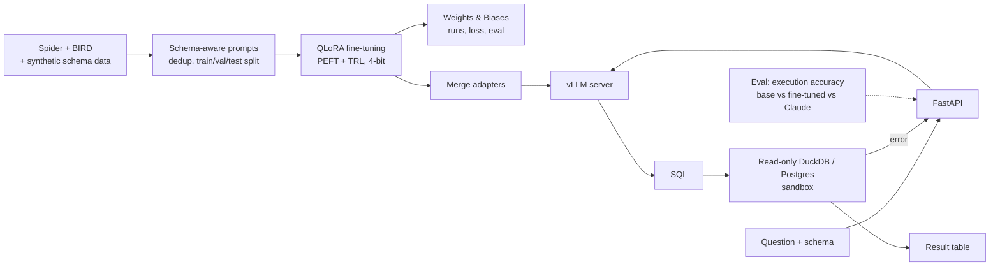

# SQL Copilot

**A small open-weight model, fine-tuned with QLoRA to turn analytics questions into correct SQL,
and evaluated head-to-head against a frontier model.**

> 🚧 **Status: in development.** This README is the design document. Nothing below is a measured
> result yet; numbers in the evaluation section are targets.

## Why this project

Text-to-SQL is one of the most common real uses of LLMs in data teams, and it is easy to measure
honestly: run the generated query and compare the result with the reference. The project
answers a practical question companies actually face:

> Can a fine-tuned 7B model, running on our own GPU, get close enough to a frontier API on our
> schema to be worth the cost and privacy benefits?

## What it will do

- Fine-tune an open-weight code model (7B–8B class, e.g. Qwen-Coder) with **QLoRA** on
  text-to-SQL data (Spider, BIRD) plus synthetic examples for a custom e-commerce schema.
- Add a **self-correction loop**: execute the query in a sandboxed read-only database, feed the
  error back, retry once.
- Serve the merged model with **vLLM** behind a FastAPI endpoint.
- Compare against prompting the base model (zero/few-shot) and a frontier model (Claude API) on
  the same held-out questions, reporting accuracy, latency and cost per 1,000 queries.

## Architecture

## Tech stack

| Layer | Choice |
| --- | --- |
| Modeling | PyTorch, Hugging Face Transformers, PEFT (LoRA/QLoRA), TRL, bitsandbytes |
| Data | Spider, BIRD, synthetic data generated and execution-validated |
| Experiment tracking | Weights & Biases |
| Serving | vLLM (OpenAI-compatible server), FastAPI |
| Execution sandbox | DuckDB and PostgreSQL, read-only role, statement timeout |
| Baseline | Claude API with the same schema prompt |
| Delivery | Docker; training notebooks on a single rented GPU (Colab / Kaggle / RunPod) |

## Evaluation plan

| Metric | Definition | Target |
| --- | --- | --- |
| Execution accuracy (Spider dev) | Result set matches the reference | Fine-tuned ≥ base + 15 points |
| Execution accuracy (BIRD dev) | Harder, dirtier schemas | Reported for all three models |
| Valid-SQL rate | Parses and runs without error | ≥ 95% after self-correction |
| p50 / p95 latency | vLLM on one GPU | Reported |
| Cost per 1k queries | GPU-hour cost vs API pricing | Reported |

Ablations: LoRA rank, with vs without schema linking in the prompt, with vs without
self-correction, training data size.

## Milestones

- [ ] Data pipeline with schema-aware prompt format
- [ ] Baselines: base model zero/few-shot, Claude
- [ ] First QLoRA run, execution-accuracy harness
- [ ] Hyper-parameter and ablation sweeps tracked in W&B
- [ ] Self-correction loop against the sandbox database
- [ ] vLLM serving + FastAPI, latency benchmark
- [ ] Results table and write-up; model card on Hugging Face Hub

## Getting started

Setup instructions will land with the first working milestone.

## Author

Chirag Batra · [GitHub](https://github.com/thechiragbatra) · [LinkedIn](https://www.linkedin.com/in/chirag-batra-ds)
